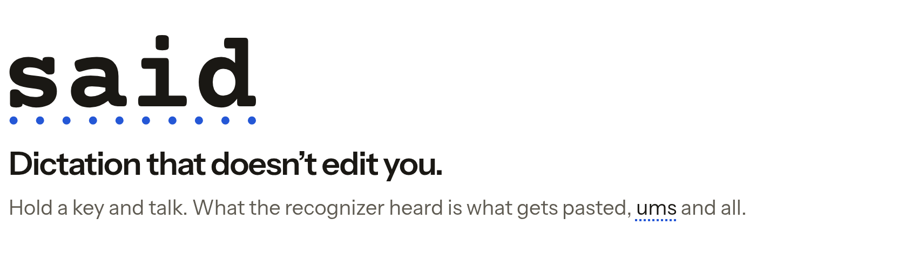

<picture>
  <source media="(prefers-color-scheme: dark)" srcset="docs/header-dark.png">
  
</picture>

# said

**Dictation that doesn't edit you.**

Hold a key and talk. What the recognizer heard is what gets pasted, ums and all.

said is a local dictation app for macOS and Linux (Niri), built for talking to Claude Code, Codex and terminals. It saves the recognizer's finalized text before pasting it. There is no language model cleanup pass. Your own edits stay separate from the original recognition. Enter is sent only when you enable it for an app.

Any recognizer can mishear. Both platforms use Parakeet TDT v3 FP32 through sherpa-onnx on CPU. [Benchmark results](bench/RESULTS.md) report errors, performance and reference limitations. The default is provisional; it has not passed every fidelity and delivery gate.

## Status

This is a working implementation under development, not a certified release. Capture, local recognition, history, interactive editing, settings and setup are connected. Controlled Linux tests cover exact paste into scratch targets without Enter, including a nested-Niri run of the Parakeet app. They do not establish physical keyboard access, every microphone or every destination.

The Apple Silicon app has build and [native unit-test receipts](crates/platform/macos/VERIFICATION.md). Live macOS capture, permissions, focus and paste acceptance remain pending in a separate test account. Packaging produces an Arch package, a portable Linux tar directory and an ad-hoc signed macOS app/DMG. The Mac build is not notarized. The Linux tar is not an AppImage and has not been certified across distributions.

## Install

Build the artifacts below. For an Arch package:

```sh
sudo pacman -U said-*.pkg.tar.zst
```

On Niri, add the provided configuration includes after reviewing them. Setup and `said status` explain the active input mode. Readable keyboards or a working shortcuts portal provide hold and release; a compositor bind alone toggles on each press. Input-group access requires a new login and permits reading physical keyboard events. See [Linux setup](packaging/INSTALL.md#linux).

On macOS, copy `said.app` from the DMG into `/Applications`, open it in Finder, then grant Microphone, Accessibility and Input Monitoring in Setup/System Settings. An ad-hoc build needs macOS's explicit first-open approval. See [macOS setup](packaging/INSTALL.md#macos).

## Build from source

Use Rust 1.90+ and Bun 1.4+. Start in a checkout of this repository.

On Arch Linux, install the [build dependencies](packaging/README.md#arch-and-cachyos), then:

```sh
cd packaging/linux
systemd-run --user --scope -q -p MemoryMax=4G -p MemorySwapMax=0 -- env CARGO_BUILD_JOBS=2 makepkg
```

On Apple Silicon with macOS 14+, install Xcode command-line tools, Rust, Bun, jq and OpenSSL. The build script requires the desktop to have been idle for five minutes:

```sh
nice -n 10 packaging/macos.sh
```

Both paths embed the UI and pinned native runtime. Model weights download on first launch and are checked against SHA-256 hashes. [Packaging](packaging/README.md) covers output paths and portable Linux staging; [CONTRIBUTING.md](CONTRIBUTING.md) covers development without launching a desktop app.

## How it works

The overlay shows provisional words while you talk. Final chunks append without a cleanup pass. Quick dictation saves before checking focus and posting the paste chord. When delivery is withheld, the text stays in history for explicit insertion. Interactive review lets you edit, play the recording, and insert. History keeps audio and original text until you delete them; retries share the recording and create a new recognition.

Recognition runs locally. Model downloads are network requests; recordings are not uploaded. The clipboard keeps the inserted text. A successful paste means the chord was posted, not that the destination accepted it. See [SPEC.md](SPEC.md) for behavior and current limits, and [CONTRACTS.md](CONTRACTS.md) for adapter ordering.

## Credits and licenses

said's code is [MIT](LICENSE). NVIDIA's Parakeet model weights are CC-BY-4.0; the ONNX export is by the sherpa-onnx maintainer. sherpa-onnx is Apache-2.0; ONNX Runtime is MIT with additional dependency notices. The macOS input and panel code adapts work from [Handy](https://github.com/cjpais/Handy) and [tauri-nspanel](https://github.com/ahkohd/tauri-nspanel), with their MIT credits retained.

Courier Prime supplies the app's original-recognition font; Instrument Sans and Courier Prime appear in the README artwork. Both use the SIL Open Font License. Public benchmark excerpts credit the AMI Consortium under CC-BY-4.0. Synthetic clips use Piper's LJSpeech voice; Piper and its voice models are development tools and are not bundled in the app.

[NOTICE](NOTICE) identifies the components and their terms. Full licenses and notices accompany the app, Arch package and portable tar. [Corpus licenses](bench/LICENSES.md) describe the benchmark audio separately.
